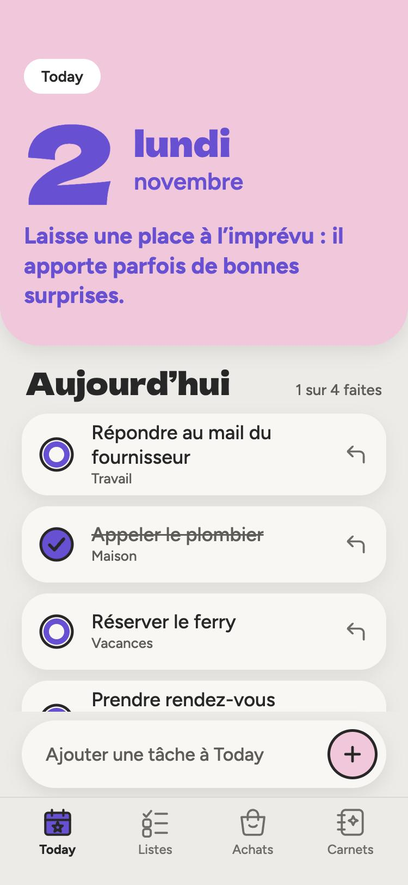
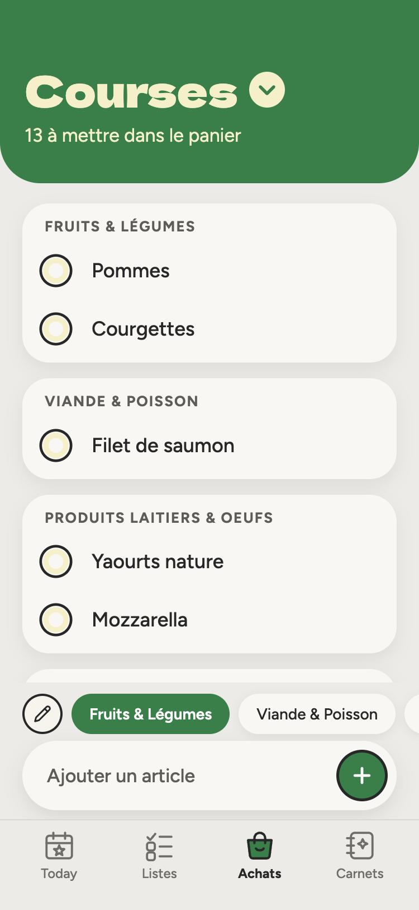
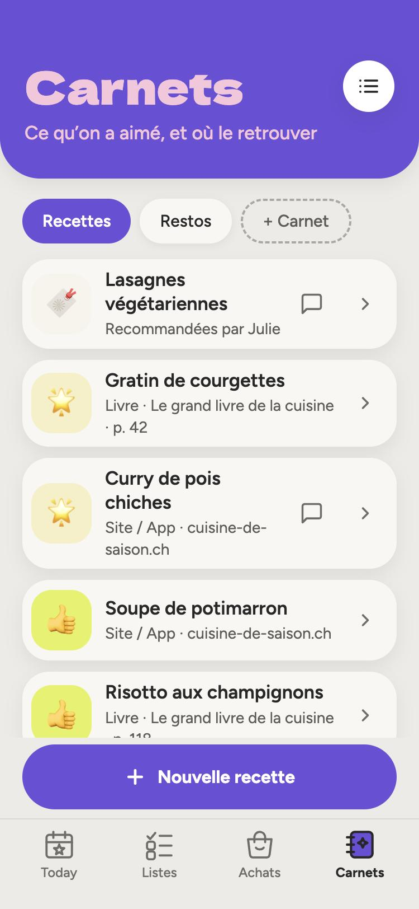
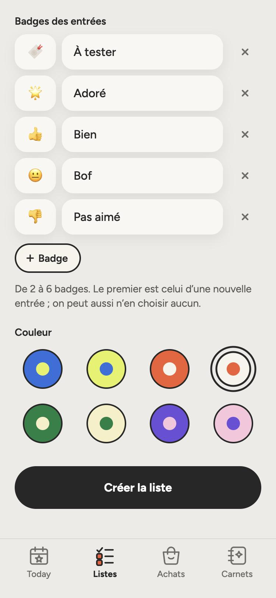
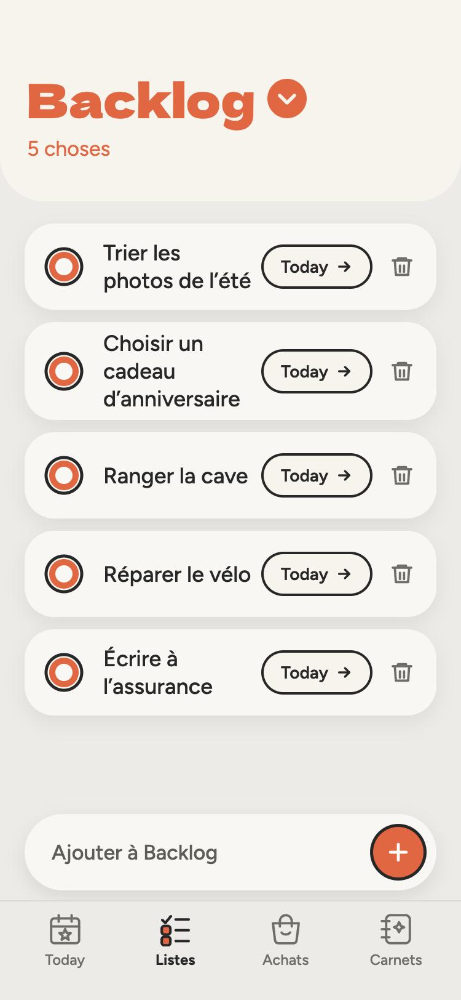
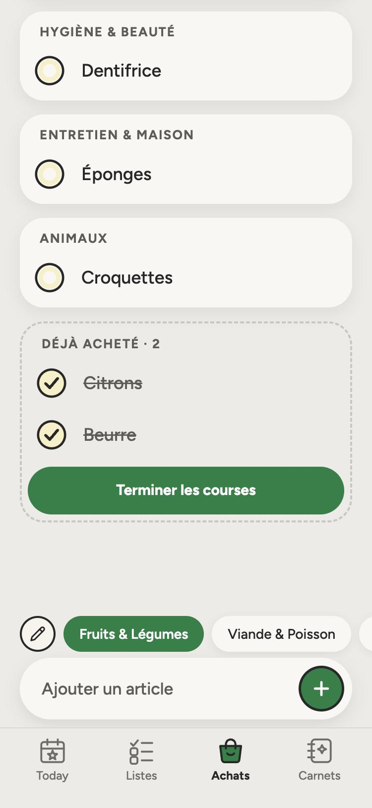
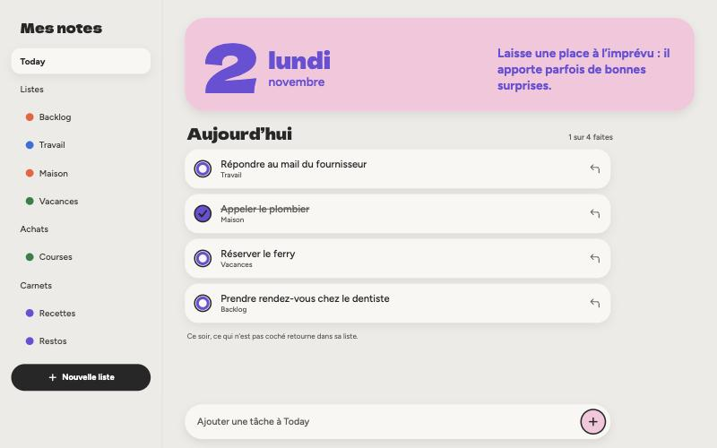

# 📝 Mes notes

**Les tâches du jour, les listes, les courses et les carnets, dans une seule app faite sur mesure.**
Sans compte, sans serveur, installable sur le téléphone, et qui marche même hors ligne.

### 👉 [**Essayer l'app : boldnote.vercel.app**](https://boldnote.vercel.app/) 👈

 

   

> [!IMPORTANT]
> **Code source privé**, disponible sur demande. Ce dépôt ne contient que la présentation du projet.

> [!TIP]
> **Sur iPhone** : ouvrir le lien dans Safari → Partager → *Sur l'écran d'accueil*. **Sur Android** : menu ⋮ → *Installer l'application*. Elle s'ouvre ensuite en plein écran, comme une app native.

---

## ✨ Ce que fait l'app

<table>
  <tr>
    <td width="50%" valign="top">
      <h3>⭐ Today</h3>
      Le matin, on pioche des tâches dans ses listes et on les envoie dans Today. Le soir, ce qui n'est pas coché <b>retourne tout seul dans sa liste d'origine</b>, le reste est archivé. Chaque jour a sa couleur et sa phrase.
    </td>
    <td width="50%" valign="top">
      <h3>📋 Listes</h3>
      Autant de listes de tâches qu'on veut, chacune avec sa couleur. Une tâche cochée reste barrée jusqu'à minuit (la satisfaction !), puis elle est archivée.
    </td>
  </tr>
  <tr>
    <td width="50%" valign="top">
      <h3>🛒 Courses</h3>
      Les articles sont rangés <b>par rayon</b>, et les rayons se gèrent librement. Un article coché passe dans « Déjà acheté » ; <i>Terminer les courses</i> les archive en gardant la date.
    </td>
    <td width="50%" valign="top">
      <h3>📖 Carnets</h3>
      Recettes, films, restos, lieux à visiter… Chaque carnet a <b>ses propres badges</b> (« À tester », « Adoré », « Vu »…), une source (livre, site, lieu) et un commentaire.
    </td>
  </tr>
</table>

<table>
  <tr>
    <td align="center"> <b>Listes</b> envoyer une tâche dans Today</td>
    <td align="center"> <b>Déjà acheté</b> et « Terminer les courses »</td>
    <td align="center"> <b>Personnalisation</b> badges et couleurs au choix</td>
  </tr>
</table>

 Sur ordinateur, la navigation passe dans une barre latérale.

## 🧠 Choix de conception

| Le défi | La solution |
|---|---|
| **Pas de serveur, mais une fin de journée à minuit** | Au lancement, à minuit si l'app est ouverte, et au retour sur l'onglet, elle compare la date du jour à celle des tâches et fait le ménage. Une transaction, rejouable sans danger. |
| **Une phrase et une couleur « du jour » sans réseau** | Calculées à partir du numéro du jour (jours écoulés depuis 1970, heure locale) : identiques toute la journée, différentes demain, rien à stocker ni à télécharger. |
| **Des données qui évoluent sans rien casser** | Dexie gère 10 versions du schéma, avec des migrations qui transforment les données déjà présentes (les anciennes notes devenues des badges, par exemple). |
| **Un code qui reste lisible** | Types, accès aux données, logique (hooks) et affichage (composants) sont dans des couches séparées : un composant ne parle jamais directement à la base. |
| **Un design cohérent** | Maquettes d'abord, puis palette, typographie et ombres devenues des variables Tailwind partagées. Vrais boutons, étiquettes ARIA, focus visible au clavier. |
| **Marcher partout, même sans réseau** | Service worker (≈ 500 Ko en cache) et polices embarquées : aucune requête externe, l'app s'ouvre en mode avion. |

## 🛠️ Technique

| | |
|---|---|
| Interface | React 19, TypeScript 5.9 |
| Style | Tailwind CSS 4 (palette et polices dans `@theme`) |
| Données | Dexie 4 (IndexedDB) |
| Build | Vite 8 |
| App installable | `vite-plugin-pwa` (manifeste + service worker Workbox) |
| Polices | Figtree et Dela Gothic One, via `@fontsource` |
| Hébergement | Vercel |
| Qualité | ESLint, TypeScript |

## 🧭 Limites connues et suite

- [x] Tâches, Today avec fin de journée, courses par rayon, carnets avec badges
- [x] Installable (PWA), hors ligne, en ligne sur Vercel
- [ ] **Export / import** : les données restent sur l'appareil (pas de synchronisation, pas de sauvegarde ailleurs), un fichier de sauvegarde est la prochaine étape
- [ ] Modifier une tâche, renommer une liste, déplacer une tâche vers une autre liste
- [ ] Ranger automatiquement les courses par rayon
- [ ] Une note et un magasin par produit, puis un budget
- [ ] Un écran « Terminées » pour retrouver les tâches archivées
- [ ] Tests automatisés (pour l'instant, vérification à la main)

> [!NOTE]
> **Barre du haut sur iPhone.** Depuis iOS 26.1, les apps installées affichent un voile système au-dessus de la page. C'est un [bogue d'iOS](https://bugs.webkit.org/show_bug.cgi?id=301994) qui touche toutes les PWA ; ça ne gêne pas l'usage.

## 🧰 Outils

Maquettes réalisées avec Claude Design. Code écrit avec l'aide de Claude Code, un assistant de programmation d'Anthropic.

Projet personnel · École 42 · © 2026 Tous droits réservés

